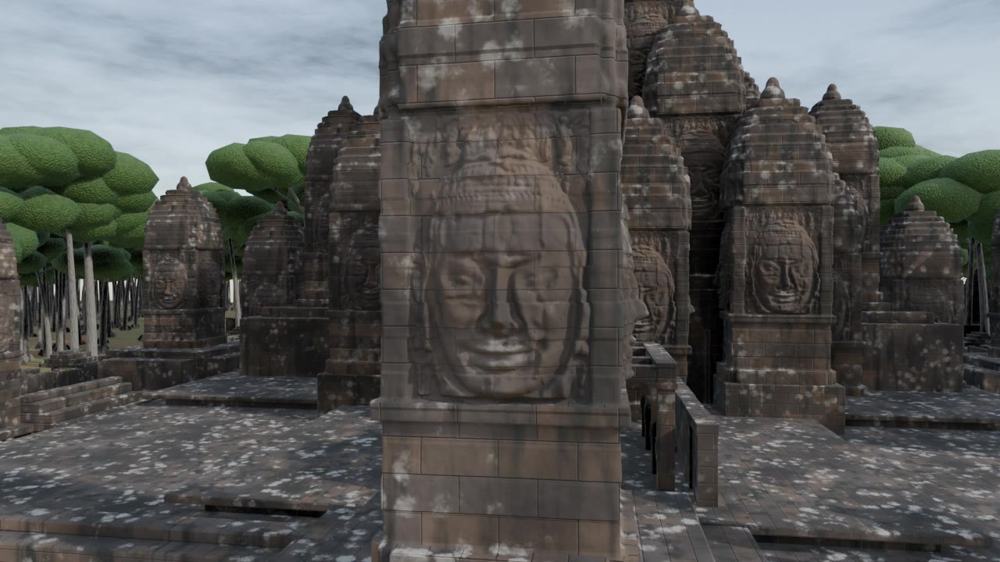
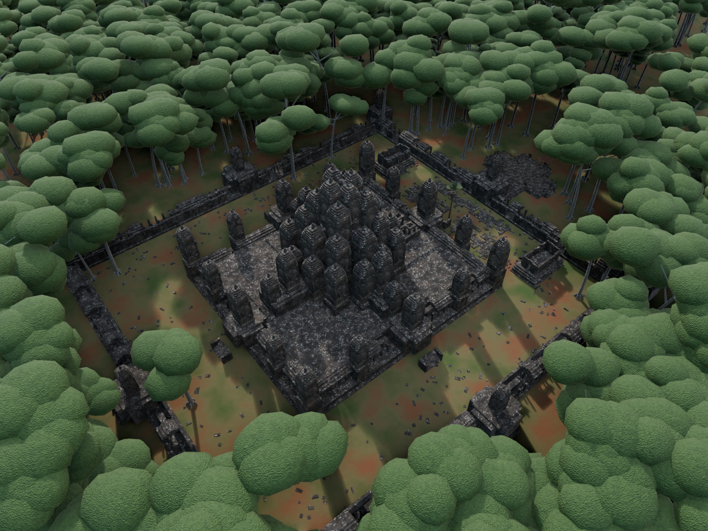
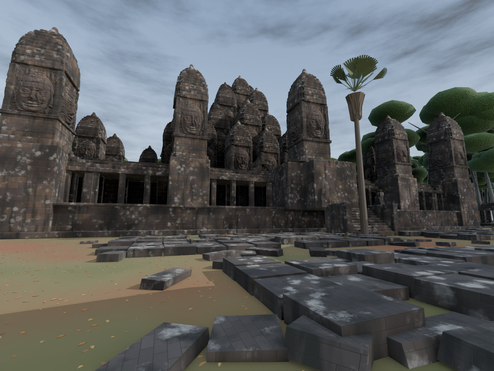
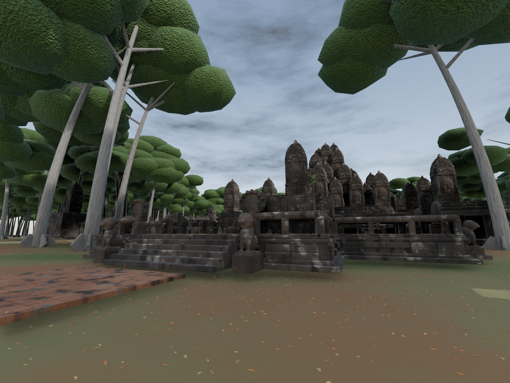
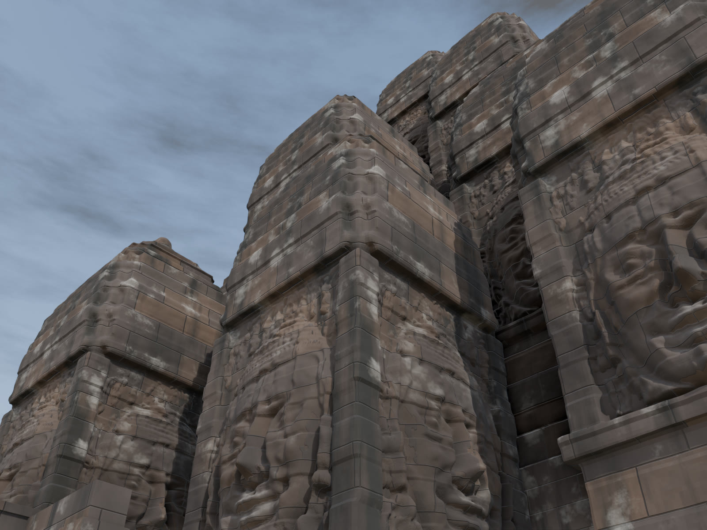
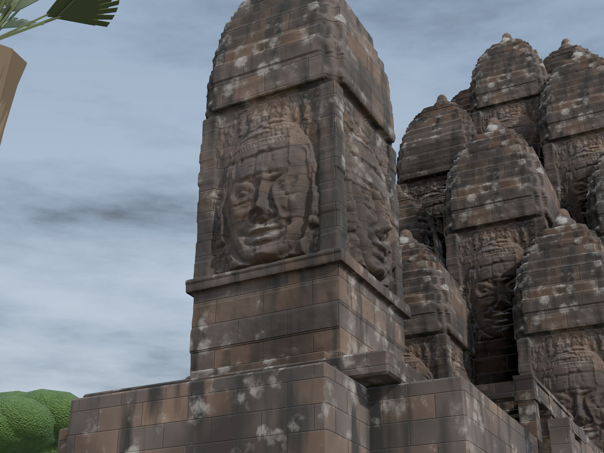
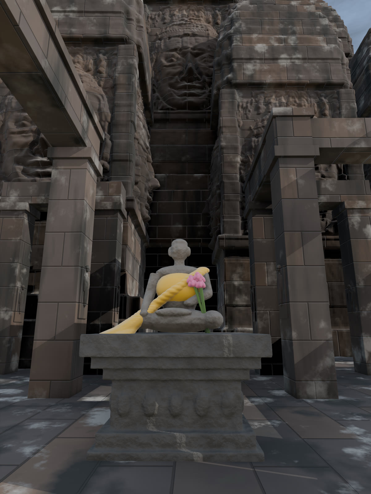
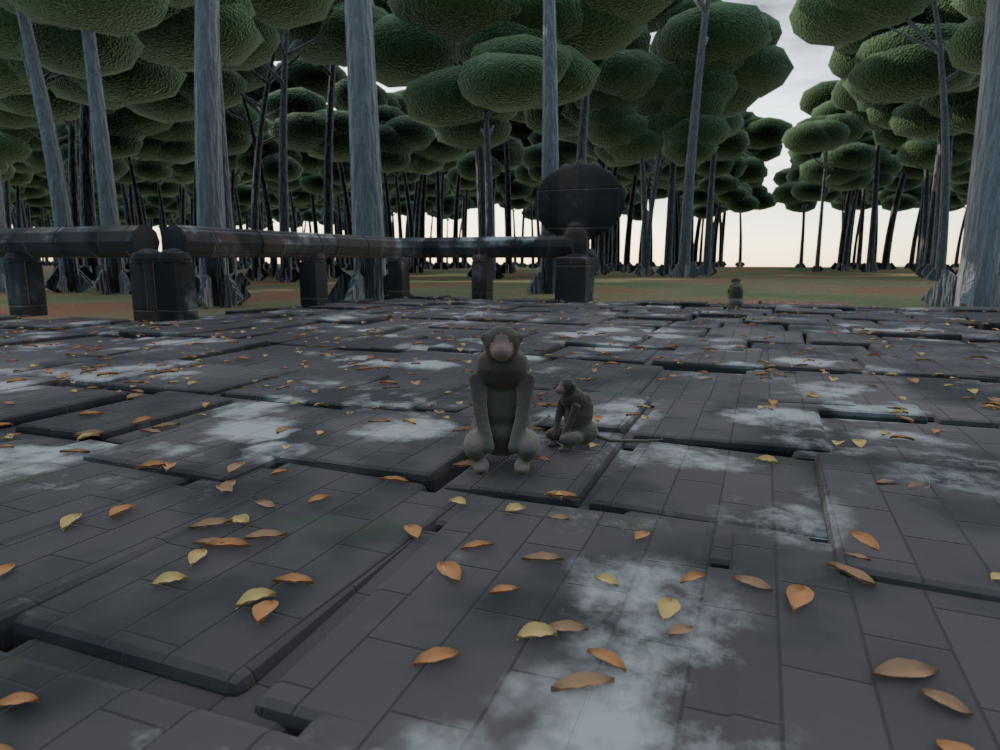
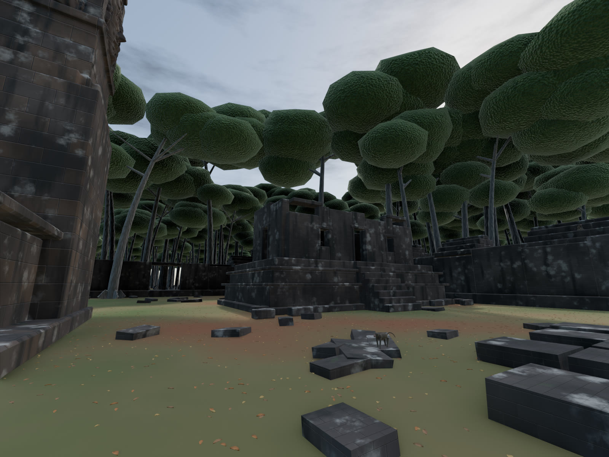

# Blender Bayon Inspiration

Une reconstruction 3D stylisée du temple du **Bayon** (Angkor Thom, Cambodge), réalisée dans Blender.

Ce projet est un **petit test pour utiliser Blender avec son MCP** ([MCP for Blender](https://mcp-for-blender.com)) : toute la scène a été construite en pilotant Blender depuis un assistant IA, par scripts Python successifs. La construction a été faite **à partir de photos prises par moi-même lors de mon voyage au Cambodge en 2024**.

## 🎬 La vidéo

[](video/bayon_survol_drone.mp4)

**▶ [Voir le survol en drone (MP4, 70 s, 1280×720)](video/bayon_survol_drone.mp4)**

Le drone arrive au-dessus de la forêt, puis s'arrête quelques secondes sur la terrasse d'entrée est, une bibliothèque, un visage du Bayon, le sanctuaire au bouddha et l'amas de tours centrales, avant de s'envoler.

## Galerie

| | |
|---|---|
|  |  |
|  |  |
|  |  |
|  |  |

## Ce que contient la scène

- Galerie extérieure (≈ 156 × 141 m) en ruine, galerie intérieure surélevée, terrasse supérieure en croix et sanctuaire central (≈ 45 m).
- 54 tours à quatre visages souriants (copies liées d'un même modèle), avec assises de blocs décalées, pierre gris-brun et lichen.
- Terrasse d'entrée est dallée avec balustrades en nagas et lions, allée en latérite, deux bibliothèques, salle à piliers et sanctuaire au bouddha drapé de safran.
- Forêt de ≈ 2 700 grands arbres, palmier à sucre, macaques, feuilles mortes, ciel nuageux.

## Utiliser le fichier dans Blender

1. Installer **Blender 4.3 ou plus récent** (testé avec Blender 4.3.2).
2. Ouvrir [`bayon_temple.blend`](bayon_temple.blend). Le fichier est autonome : aucune texture externe, tout est procédural.
3. Passer la vue 3D en mode **Rendu** (touche `Z` → *Rendered*) pour voir les matériaux. La scène est lourde : repasser en mode *Solid* si la navigation saccade.

Moteur : **EEVEE** (Blender 4.2+). Caméras prêtes à l'emploi :

| Caméra | Vue |
|---|---|
| `Cam_Drone` | Survol animé, images 1 à 1681 (24 i/s, 70 s), caméra active |
| `Cam_Aerial` | Vue aérienne |
| `Cam_Ground_East` | Cour est, au sol |
| `Cam_East_Terrace` | Terrasse d'entrée est |
| `Cam_Tower_Up` | Groupe de tours en contre-plongée |
| `Cam_Face_Closeup`, `Cam_Face_Detail`, `Cam_Face_Front` | Visages |
| `Cam_Shrine` | Sanctuaire au bouddha |
| `Cam_Monkeys` | Singes sur le dallage |
| `Cam_Library` | Bibliothèque |

Pour changer de caméra : la sélectionner puis `Ctrl` + `Pavé numérique 0`.
Pour rendre l'animation : *Rendu → Rendre l'animation* (sortie dans `rendus/`), ou en ligne de commande :

```bash
blender -b bayon_temple.blend -a
```

Compter environ 2 s par image en 1280×720 (16 échantillons EEVEE).

## Musique de la vidéo

- **Titre :** Royal of Angkor
- **Auteur :** [Chheng_Flim](https://pixabay.com/users/chheng_flim-47988978/)
- **Source :** [pixabay.com/music/instrumental-royal-of-angkor-582928](https://pixabay.com/music/instrumental-royal-of-angkor-582928/)
- **Droits :** utilisée sous la [Pixabay Content License](https://pixabay.com/service/license-summary/) (« Free for use »). Cette licence autorise l'utilisation gratuite de la musique dans une vidéo, sans crédit obligatoire. Elle interdit en revanche de redistribuer la musique seule : c'est pourquoi le fichier audio n'est pas fourni dans ce dépôt, seulement la vidéo qui l'intègre. Pour réutiliser la musique, la télécharger depuis sa page Pixabay.
- **Extrait utilisé :** 0:00 à 1:10, avec fondus d'entrée et de sortie.

## Crédits et références

- Modélisation, matériaux et animation : générés dans Blender via MCP for Blender, à partir de mes photos du Bayon (Cambodge, 2024).
- Le relief des visages des tours a été dérivé d'une image de scan 3D d'un visage du Bayon trouvée en ligne ; cette image n'est pas incluse dans le dépôt.
- La reconstruction est une interprétation artistique, pas un relevé archéologique : proportions, nombre et position des tours sont approximatifs.
